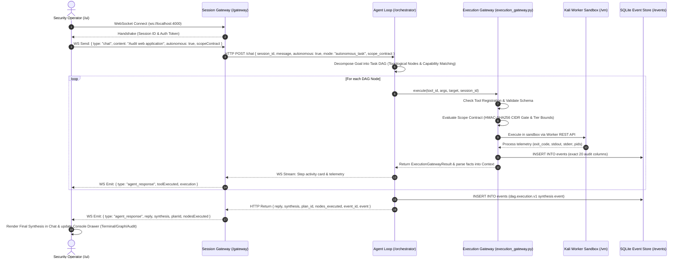
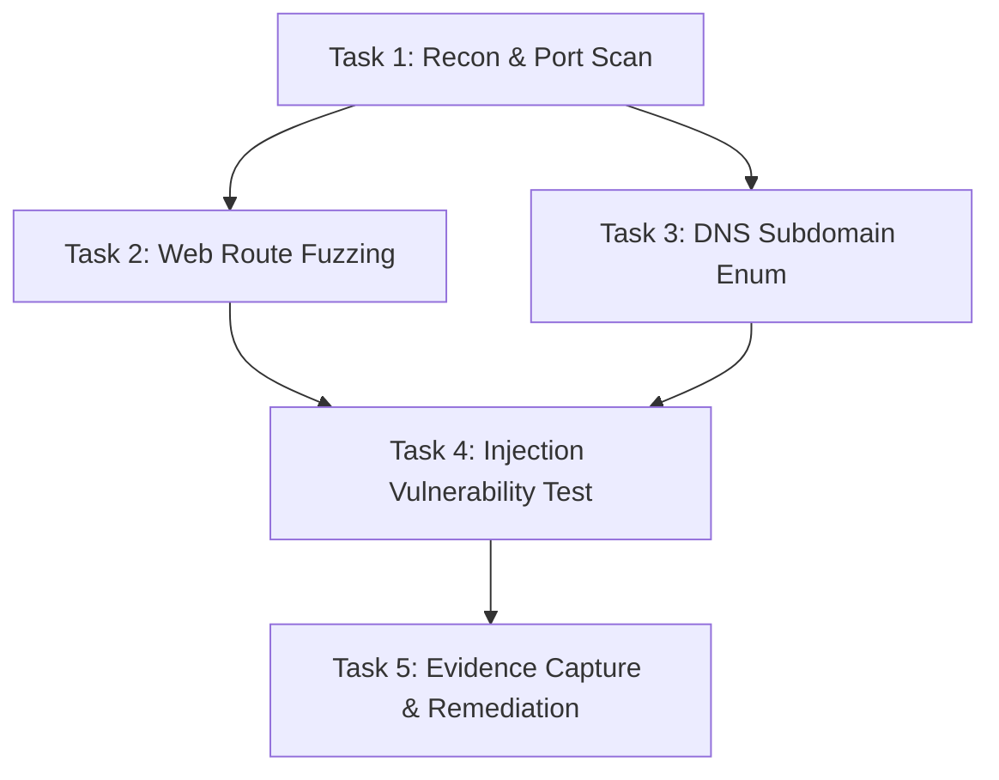
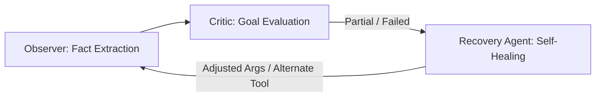
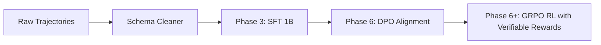

# KAIRO: Autonomous Conversational Cyber Defense & Red-Team Agent

An enterprise-grade, local-first autonomous cybersecurity agent platform engineered for defensive auditing, red-team assessments, and automated vulnerability verification. Kairo accepts natural language objectives, autonomously classifies intent, plans multi-step security assessment DAGs, executes across 27+ Kali Linux tools, dynamically chains tool outputs to adapt the DAG mid-execution upon uncovering new attack surfaces, and delivers conversational synthesis reports with 3–5 proactive click-to-run recommendations.

Kairo couples specialized Small Language Models (380M to 2B parameters, fine-tuned via SFT, DPO, and GRPO, including flagship Kairo Scale 2B) with deterministic tool schemas (`toolspec.schema.json`), fast schema self-correction, an automated failover router, cryptographic CIDR scope boundaries, an authoritative Execution Gateway, persistent SQLite trajectory recording for continuous learning, and isolated Kali Linux virtualization.

---

## Complete Documentation Suite

### Core Architecture & System Guides

| Document | Path | Scope & Focus |
| :--- | :--- | :--- |
| **System Architecture** | [`docs/ARCHITECTURE.md`](docs/ARCHITECTURE.md) | Monorepo service topology, boundaries, process execution lifecycle, IPC protocols, and fault recovery |
| **API & Protocol Reference** | [`docs/API_REFERENCE.md`](docs/API_REFERENCE.md) | Gateway WebSocket protocol, Orchestrator FastAPI REST routes, Kali worker REST API, and SQLite 20-field audit schema |
| **Claude UI Design System** | [`DESIGN.md`](DESIGN.md) | Anthropic Claude Warm Dark design language, design tokens, Newsreader typography, interactive state specs, and visual component architecture |
| **Claude UI Specification** | [`docs/CLAUDE_UI_SPEC.md`](docs/CLAUDE_UI_SPEC.md) | Component catalog, welcome screen, starter prompts, thinking accordions, artifact cards, and mobile responsive layout |
| **ToolSpec Guide & SDK** | [`docs/TOOLSPEC_GUIDE.md`](docs/TOOLSPEC_GUIDE.md) | 16-field declarative ToolSpec schema, authoring workflow, 7-Gate Conformance Engine, and registry loading |
| **Security & Scope Contracts** | [`docs/SECURITY_AND_SCOPE.md`](docs/SECURITY_AND_SCOPE.md) | Cryptographic HMAC-SHA256 scope authorization, CIDR IP validation, and Kali VM sandbox zero-trust containment |
| **Deployment & Setup** | [`docs/DEPLOYMENT_AND_SETUP.md`](docs/DEPLOYMENT_AND_SETUP.md) | Step-by-step local development setup, VirtualBox Kali VM provisioning, Docker lab targets, and troubleshooting |
| **Training & Autonomous Evolution** | [`docs/TRAINING_AND_EVOLUTION.md`](docs/TRAINING_AND_EVOLUTION.md) | Continuous self-improvement loop, evolution policies, scale stages (380M to 2B), SFT, DPO, and GRPO with verifiable rewards |
| **Evaluation & Benchmarks** | [`docs/EVALUATION_AND_BENCHMARKS.md`](docs/EVALUATION_AND_BENCHMARKS.md) | 50-task Golden & 120-task Full Benchmark suites, scoring metrics, and model leaderboard comparisons |
| **Testing & Quality Assurance** | [`docs/TESTING_AND_QA.md`](docs/TESTING_AND_QA.md) | Master 23-suite test matrix (189 verified passing tests, 100% pass rate), 7-Gate conformance certification, and chaos engineering |
| **Contributing Guide** | [`docs/CONTRIBUTING.md`](docs/CONTRIBUTING.md) | Code style, commit standards, test requirements, 7-gate certification workflow, and pull request checklist |

### Subsystem Technical References

| Subsystem | Path | Description |
| :--- | :--- | :--- |
| **Agent Orchestrator** | [`orchestrator/README.md`](orchestrator/README.md) | Cognitive loop, DAG planner, critic, recovery agent, failover router, model evolution controller, and process supervisor |
| **Model Registry & Weights** | [`models/README.md`](models/README.md) | `models.yaml` configuration, GGUF local weights, custom Kairo-Scale checkpoints, and Model Center |
| **Model Training & Alignment** | [`training/README.md`](training/README.md) | PyTorch Transformer architecture, pretraining, Hugging Face TRL SFT, DPO preference tuning, and GRPO |
| **ToolSpec Registry** | [`registry/README.md`](registry/README.md) | 27 production ToolSpec YAML definitions, 16-field JSON schema, and multi-language loaders |
| **ToolSpec SDK & Extensions** | [`sdk/README.md`](sdk/README.md) | CLI scaffolding generator, 7-Gate Conformance Engine, and certified third-party extensions |
| **Audit Event Store** | [`events/README.md`](events/README.md) | 20-field SQLite schema, indexed timeline queries, finding cards, and forensic evidence artifacts |
| **Session Gateway** | [`gateway/README.md`](gateway/README.md) | TypeScript WebSocket session multiplexer, token authorization, and real-time streaming |
| **Claude Warm Dark UI** | [`ui/README.md`](ui/README.md) | Next.js 16 + React 19 web interface, Tauri desktop shell, and component catalog |
| **Virtualization Sandbox** | [`vm/README.md`](vm/README.md) | Kali Linux VM worker agent, socket/HTTP RPC, resource caps, and automated snapshot rollback |
| **Vulnerability Lab** | [`lab/README.md`](lab/README.md) | Docker Compose targets (Mini-DVWA, Mini-Metasploitable), benchmark tasks, and multi-model sweep history |
| **Scripts & Tooling** | [`scripts/README.md`](scripts/README.md) | Chaos testing, automated UI screenshot capture, benchmark expansion, and stress harnesses |
| **External Binaries** | [`tools/README.md`](tools/README.md) | Standalone utilities including Cloudflare Tunnel (`cloudflared`) |

---

## Table of Contents

- [Claude UI Architecture & Visual Interface](#claude-ui-architecture--visual-interface)
- [1. Monorepo Architecture & Service Topology](#1-monorepo-architecture--service-topology)
- [2. Quickstart & Service Orchestration](#2-quickstart--service-orchestration)
- [3. Local Model Plumbing & Grammar Constraints (`llama.cpp`)](#3-local-model-plumbing--grammar-constraints-llamacpp)
- [4. Isolated Kali Linux VM Sandbox & Snapshot Lifecycle](#4-isolated-kali-linux-vm-sandbox--snapshot-lifecycle)
- [5. ToolSpec Engine & Tier 1 / Tier 2 Security Adapters](#5-toolspec-engine--tier-1--tier-2-security-adapters)
- [6. Task Isolation, Active Resource Caps & Forensics](#6-task-isolation-active-resource-caps--forensics)
- [7. Autonomous Planner & Directed Acyclic Graph (DAG) Engine](#7-autonomous-planner--directed-acyclic-graph-dag-engine)
- [8. Hybrid Tool Selection Engine & Tool Memory Store](#8-hybrid-tool-selection-engine--tool-memory-store)
- [9. Scope Contract: Cryptographic HMAC-SHA256 Authorization Gate](#9-scope-contract-cryptographic-hmac-sha256-authorization-gate)
- [10. Observer, Critic & Recovery Agent: Self-Healing Cognitive Loop](#10-observer-critic--recovery-agent-self-healing-cognitive-loop)
- [11. Evidence Store, Finding Cards & Report Generator](#11-evidence-store-finding-cards--report-generator)
- [12. Versioned Lab Targets & Benchmark Runner](#12-versioned-lab-targets--benchmark-runner)
- [13. Model Training Pipeline: SFT, DPO & GRPO with Verifiable Rewards](#13-model-training-pipeline-sft-dpo--grpo-with-verifiable-rewards)
- [14. Cross-Platform Execution Plane, Tauri Shell & Mobile Clients](#14-cross-platform-execution-plane-tauri-shell--mobile-clients)
- [15. Kali Desktop GUI Streaming & Tier 3 GUI Tool Adapters](#15-kali-desktop-gui-streaming--tier-3-gui-tool-adapters)
- [16. Playwright-Driven Security Browser (`browser.security.v1`)](#16-playwright-driven-security-browser-browsersecurityv1)
- [17. ToolSpec SDK & Third-Party Extension Framework](#17-toolspec-sdk--third-party-extension-framework)
- [18. Public Benchmark Leaderboard & Multi-Model Version Score History](#18-public-benchmark-leaderboard--multi-model-version-score-history)
- [19. Master Verification & Test Suite Matrix](#19-master-verification--test-suite-matrix)

---

## Claude UI Architecture & Visual Interface

Kairo features an executive-grade frontend interface faithfully modeled after the **Anthropic Claude UI**, blending literary, book-inspired visual quiet with high-density security operational tooling:

- **Warm Dark Slate Palette**: Built on deep warm slate backgrounds (`#181816`), warm obsidian sidebars (`#141413`), stone borders (`#2d2c28`), and Anthropic's signature Terracotta Coral accent (`#d97757`).
- **Editorial Typography**: Pairing serif headlines (`Newsreader` / `Lora`) with crisp sans-serif text (`Inter`) and monospace code formatting (`JetBrains Mono`).
- **Signature Claude Welcome Screen**: Features the 8-point terracotta starburst spark icon, welcome greeting, and a responsive 2x2 grid of starter prompts with pre-filled scope presets.
- **Claude Model Selector**: Header dropdown offering seamless selection between canonical, fully local models: *Kairo Scale 2B (Custom Primary)* (GRPO reasoning weights), *Qwen2.5-0.5B (Local Fallback)* (quantized GGUF), *Kairo GRPO Final (Reasoner)*, and *Qwen3-Coder-30B (MoE Base)* with zero remote cloud dependencies.
- **Claude 3.7 Extended Thinking Accordion**: Collapsible thinking blocks displaying real-time cognitive reasoning telemetry (`✦ Thought for 1.4s ▾`).
- **Claude Artifact Cards & Collapsible DAG Steps**: Interactive inline tool deliverables featuring dual actions (copy raw JSON, deep-link to console), collapsible parameter/output step cards (`ClaudeTaskPlanNode`), and real-time execution badges.
- **Proactive Next-Step Recommendations Grid**: Context-aware follow-up cards (`ClaudeNextStepRec`) with priority badges, ToolSpec IDs, rationale explanations, and single-click prompt population into the composer.
- **Header Split-View Controls**: Instant top-bar toggles for side-by-side Terminal (`terminal`) and Kali GUI (`screen` / noVNC) workflows without navigating away from the chat conversation.
- **Floating Pill Composer**: Rounded floating input bar (`border-radius: 20px`) with integrated cryptographic Scope Contract popover and circular terracotta send button.
- **Collapsible Console & Subsystem Drawer**: Right-hand drawer with smooth toggle (`[ | ] ⚙ Advanced`), width toggling (560px standard / 880px wide), and deep subsystem views (Terminal, Kali Screen, DAG Task Graph, System Telemetry, Audit Explorer, and Benchmark Leaderboard).

### Visual Architecture & Screen Registry

| Screen View | Component Path | Architecture & Interactive Capabilities |
| :--- | :--- | :--- |
| **Claude Welcome Screen** | [`ui/src/app/page.tsx`](ui/src/app/page.tsx) | Warm dark background (`#181816`), terracotta spark monogram, and interactive starter prompt cards with scope presets. |
| **Claude Model Selector** | [`ui/src/app/page.tsx`](ui/src/app/page.tsx) | Header dropdown switching local models (Kairo Scale 2B, Qwen2.5-0.5B, Kairo GRPO, Qwen3-Coder-30B) with live backend telemetry. |
| **Header Split-View Toggles** | [`ui/src/app/page.tsx`](ui/src/app/page.tsx) | Dedicated quick-access header buttons to instantly split or open Terminal (`>_`) and Kali GUI (`Desktop`) panels. |
| **Scope Contract Popover** | [`ui/src/app/page.tsx`](ui/src/app/page.tsx) | Real-time HMAC-SHA256 signature verification badge, target CIDR bounds, excluded hosts, and countdown timers. |
| **Extended Thinking & Artifacts** | [`ClaudeOutputCard.tsx`](ui/src/app/components/ClaudeOutputCard.tsx) | Conversational stream with collapsible thinking accordions (`✦ Thought for 1.8s ▾`), verified tool cards, and synthesis reports. |
| **Collapsible DAG Step Cards** | [`ClaudeOutputCard.tsx`](ui/src/app/components/ClaudeOutputCard.tsx) | Interactive multi-step execution breakdown with expandable parameter inspection and parsed tool output viewer. |
| **Next-Step Recommendations Grid** | [`ClaudeOutputCard.tsx`](ui/src/app/components/ClaudeOutputCard.tsx) | 3–5 proactive actionable recommendation chips with ToolSpec tags, priority badges, and click-to-run prompts. |
| **Console: System Telemetry** | [`ui/src/app/page.tsx`](ui/src/app/page.tsx) | Real-time GPU VRAM meters, system RAM utilization, isolated Kali worker VM state, and air-gapped status. |
| **Console: Interactive Terminal** | [`TerminalProcessView.tsx`](ui/src/app/components/TerminalProcessView.tsx) | VT100 / Xterm.js streaming terminal connected to isolated Kali worker with interactive process supervision. |
| **Console: Kali Screen Stream** | [`ScreenPanel.tsx`](ui/src/app/components/ScreenPanel.tsx) | Low-latency RFB / noVNC virtual desktop frame buffer for interactive GUI tools (Burp Suite, Wireshark, Firefox). |
| **Console: DAG Task Graph** | [`TaskGraphView.tsx`](ui/src/app/components/TaskGraphView.tsx) | Interactive node-based Directed Acyclic Graph planner visualization showing parallel task execution and dependencies. |
| **Console: Audit Explorer** | [`AuditExplorer.tsx`](ui/src/app/components/AuditExplorer.tsx) | Immutable 20-field SQLite operational audit log inspector with JSON drilldown and search filters. |
| **Console: Benchmark Leaderboard** | [`BenchmarkLeaderboard.tsx`](ui/src/app/components/BenchmarkLeaderboard.tsx) | Multi-model evaluation history, schema validity scoring, and golden benchmark comparison matrix. |
| **Mobile Responsive View** | [`ui/src/app/page.tsx`](ui/src/app/page.tsx) | Single-column touch-friendly layout on narrow 375px viewports with full-screen drawer overlays. |

---

## 1. Monorepo Architecture & Service Topology

Kairo is built on a modular monorepo architecture with clean separation between the user interface, session gateway, autonomous agent loop, declarative tool registry, and SQLite audit event store.

```text
.
├── /ui           # Next.js 16 + React client (Chat, Event Inspector, DAG, Leaderboard, Curation)
├── /gateway      # TypeScript WebSocket & HTTP session gateway (Node.js / tsx)
├── /orchestrator # Agent loop, Planner DAG, Critic, Recovery, Evaluator (Python / FastAPI)
├── /registry     # 16-field ToolSpec YAML blueprints & language loaders (27 tools)
├── /events       # SQLite event database with strict 20-field audit schema
├── /sdk          # ToolSpec SDK: CLI generator, 7-Gate Conformance Engine & registry bridge
├── /training     # SFT, DPO, and GRPO fine-tuning pipelines, datasets & checkpoint storage
├── /lab          # Dockerized vulnerability targets (Mini-DVWA, Mini-Metasploitable) & history.json
├── /vm           # Headless Kali Linux VM worker agent & VirtualBox manager
├── /scripts      # Utility, chaos engineering, worker deployment, and toolspec creation scripts
├── /tools        # System binaries & tunneling utilities (cloudflared)
└── /tests        # Comprehensive test suites and fixtures (48 suites across all subsystems)
```

### End-to-End Service Boundary Flow



### Service Directory Breakdown

| Directory | Framework / Runtime | Default Port | Responsibility |
| :--- | :--- | :--- | :--- |
| [`/ui`](file:///c:/New%20Volume%20(D)/dev/ui) | Next.js 16 (App Router), React 19, Vanilla CSS | `3000` | Real-time chat, DAG visualizer, Scope modal, RFB desktop stream, Curation & Leaderboard |
| [`/gateway`](file:///c:/New%20Volume%20(D)/dev/gateway) | Node.js, TypeScript, `ws`, `tsx` | `4000` | Session allocation, WebSocket multiplexing, RPC proxying to Orchestrator |
| [`/orchestrator`](file:///c:/New%20Volume%20(D)/dev/orchestrator) | Python 3.12+, FastAPI, Uvicorn | `8000` | Agent loop, Planner, Critic, Recovery, Evaluator, Model Center & Scope Gate |
| [`/registry`](file:///c:/New%20Volume%20(D)/dev/registry) | YAML, Python & TypeScript Loaders | — | Declarative 16-field tool specifications and argument validation |
| [`/events`](file:///c:/New%20Volume%20(D)/dev/events) | SQLite (`events/events.db`) | — | Immutable 20-field operational audit log, execution telemetry, and artifacts |
| [`/sdk`](file:///c:/New%20Volume%20(D)/dev/sdk) | Python CLI & Conformance Suite | — | Third-party ToolSpec scaffolding, 7-gate certification, dynamic registry bridging |
| [`/training`](file:///c:/New%20Volume%20(D)/dev/training) | PyTorch, Hugging Face TRL, Datasets | — | SFT trajectories (2.8k), DPO preference pairs (360), GRPO reward models |
| [`/lab`](file:///c:/New%20Volume%20(D)/dev/lab) | Docker Compose, Python Runner | — | Mini-DVWA, Mini-Metasploitable, 50-task Golden & 120-task Full Benchmark |
| [`/vm`](file:///c:/New%20Volume%20(D)/dev/vm) | VirtualBox, systemd, FastAPI | `2222`, `9999` | Disposable headless Kali VM worker with automatic snapshot rollback |
| [`/scripts`](file:///c:/New%20Volume%20(D)/dev/scripts) | Python, Shell, Batch | — | Worker deployment automation, toolspec scaffolding, and maintenance utilities |
| [`/tests`](file:///c:/New%20Volume%20(D)/dev/tests) | Pytest, TypeScript | — | Full verification matrix covering boundaries, adapters, models, and security gates |

---

## 2. Quickstart & Service Orchestration

### Prerequisites

- **Python**: 3.11+ (with `venv`, `pytest`, `fastapi`, `uvicorn`, `websockets`)
- **Node.js**: v18+ with `npm`
- **Docker**: Docker Desktop or Docker Engine (for lab targets)
- **VirtualBox**: Optional (for live headless Kali VM isolation)

### Automated Test Verification

Execute the test suites to verify subsystem readiness:

```bash
# 1. Verify Model Center, GBNF grammar constraints & hardware telemetry
python tests/test_model_center.py

# 2. Verify monolithic service boundaries & WebSocket handshake
python tests/test_boundary.py

# 3. Verify Third-Party ToolSpec SDK & Conformance Engine (subfinder.enum.v1)
python -m pytest tests/test_third_party_sdk_tool_addition.py -v

# 4. Verify Dataset Curation, Training Runner & Benchmark Leaderboard
python -m pytest tests/test_dataset_curation_and_benchmark_leaderboard.py -v
```

### Starting Services Manually

To run the platform locally, open 4 terminal sessions:

#### Terminal 1: Local Model Server (`llama.cpp`)

```bash
llama-server -m models/qwen2.5-0.5b-instruct-q4_k_m.gguf --host 127.0.0.1 --port 8080 -c 4096 -ngl 99
```

#### Terminal 2: Orchestrator Core

```bash
python -m uvicorn orchestrator.server:app --host 127.0.0.1 --port 8000
```

#### Terminal 3: Session Gateway

```bash
cd gateway
npm run dev
```

#### Terminal 4: Frontend UI

```bash
cd ui
npm run dev
```

Access the UI dashboard at [`http://localhost:3000`](http://localhost:3000).

---

## 3. Local Model Plumbing & Grammar Constraints (`llama.cpp`)

Kairo wires to a local LLM running in `llama-server` mode with grammar-constrained token generation, preventing schema violations and hallucinated tool calls at the sampling layer.

### 1. Token-Level GBNF Grammar Constraints

- Uses [`orchestrator/schema_gen.py`](file:///c:/New%20Volume%20(D)/dev/orchestrator/schema_gen.py) to compile JSON Schemas into GBNF grammars.
- Generation is constrained strictly to:
  - `action: "message"` with plain text reasoning content.
  - `action: "tool_call"` with `tool_id` matching registered tools, and arguments validating against the tool's input schema.
- Malformed JSON outputs and hallucinated tools are rejected at the token sampling level.

### 2. Model Center & Runtime Configuration ([`models.yaml`](file:///c:/New%20Volume%20(D)/dev/models.yaml))

Tracks active model deployments and operational fallbacks:

```yaml
models:
  primary:
    model_id: "Kairo-GRPO-1.5B-Instruct"
    runtime: "llama.cpp"
    quantization: "Q4_K_M"
    context_length: 32768
    role: "primary"
  fallback:
    model_id: "Kairo-Base-380M"
    runtime: "llama.cpp"
    quantization: "Q4_K_M"
    context_length: 4096
    role: "fallback"
```

The endpoint `GET /model-center` reports:

- Currently loaded model and active role
- Context window token utilization
- GPU VRAM metrics (`total_mb`, `used_mb`, `free_mb`, `utilization_pct`) via `nvidia-smi`
- Host system RAM metrics via Windows `GlobalMemoryStatusEx`

---

## 4. Isolated Kali Linux VM Sandbox & Snapshot Lifecycle

Kairo executes commands inside an isolated VirtualBox Kali Linux guest VM running headless with NAT port forwarding:

```text
Host (Windows / Linux)                      Kali Linux Guest VM (VirtualBox / NAT)
┌───────────────────────────────┐           ┌─────────────────────────────────────┐
│ UI (Next.js / VM Sandbox Tab) │           │ systemd (kairo-worker.service)      │
│   ├── Live Status & Health    │           │   ├── /opt/kairo/worker_agent.py    │
│   ├── Snapshot Inventory      │           │   │   ├── GET  /health              │
│   └── 1-Click Manual Rollback │           │   │   ├── POST /execute (ToolSpec)  │
│                               │           │   │   └── POST /kill/<task_id>      │
│ Gateway (Port 4000)           │           │   └── Guest Port 9999               │
│   ├── Proxy /vm/* Endpoints   │           │                                     │
│   └── WS Event Handlers       │           │ sshd (Port 22, root enabled)        │
│                               │           └──────────────────▲──────────────────┘
│ Orchestrator (Port 8000)      │                              │
│   ├── VMManager (VBoxManage)  │ NAT Port Forwarding:         │
│   │   ├── take_snapshot()     │   Host 127.0.0.1:9999 ───────┤ (Worker Agent)
│   │   ├── rollback_snapshot() │   Host 127.0.0.1:2222 ───────┘ (SSH Access)
│   │   └── execute_in_vm()     │
│   └── SQLite Event Store      │
└───────────────────────────────┘
```

### Key Sandbox Capabilities

1. **In-Guest Worker Agent ([`vm/worker_agent.py`](file:///c:/New%20Volume%20(D)/dev/vm/worker_agent.py))**:
   - Runs as systemd service `kairo-worker.service` listening on guest port `9999`.
   - Accepts strictly-typed ToolSpec JSON requests via `POST /execute`.
   - Captures process group telemetry (`os.setsid`), start/end timestamps, stdout, stderr, and exit codes.
2. **Snapshot-Before-Task Lifecycle**:
   - When `snapshot_before=True`, host `VMManager` snapshots the VM prior to task dispatch.
   - Clean baseline snapshot: `kairo_worker_ready`.
   - One-click rollback restores the snapshot in seconds without leaving orphaned artifacts.
3. **Execution Kill Switch**:
   - `POST /kill/{task_id}` sends `SIGKILL` to the process tree, terminating runaway commands.

---

## 5. ToolSpec Engine & Tier 1 / Tier 2 Security Adapters

### 16-Field Blueprint Schema Validation

Every tool specification in `registry/tools/` is verified against the 16 core blueprint schema fields:

```text
id, binary, category, capabilities, inputs, outputs, side_effects, privilege,
gui, parser, prerequisites, docs, success_signals, failure_signals, rollback, version_compatibility
```

### Supported Core Tool Adapters

| Tool ID | Binary | Category | Tier | Structured Observation Output |
| :--- | :--- | :--- | :--- | :--- |
| `nmap.scan.v1` | `nmap` | `recon` | Tier 1 (XML) | Hosts, ports, state, service banners, script outputs |
| `metasploit.rpc.v1` | `msfconsole` | `exploitation` | Tier 1 (RPC) | Module results, sessions, loot, job status |
| `gobuster.dir.v1` | `gobuster` | `web` | Tier 2 (CLI) | Status codes, paths, content lengths, redirects |
| `ffuf.fuzz.v1` | `ffuf` | `web` | Tier 2 (JSON) | URLs, HTTP status, words, lines, sizes |
| `nikto.scan.v1` | `nikto` | `web` | Tier 2 (CSV/CLI) | Vulnerability items, OSVDB IDs, HTTP methods |
| `whatweb.scan.v1` | `whatweb` | `recon` | Tier 2 (JSON) | Technologies, server banners, CMS, plugins |
| `sqlmap.scan.v1` | `sqlmap` | `web` | Tier 2 (Batch) | Injection points, DBMS type, vulnerable parameters |
| `hydra.brute.v1` | `hydra` | `exploitation` | Tier 2 (CLI) | Discovered valid credentials (service/login/password) |
| `searchsploit.search.v1` | `searchsploit` | `recon` | Tier 2 (JSON) | Exploit titles, CVEs, paths, types, platforms |
| `whois.lookup.v1` | `whois` | `recon` | Tier 2 (CLI) | Registrars, creation/expiry dates, nameservers |
| `dig.lookup.v1` | `dig` | `recon` | Tier 2 (DNS) | Answer, authority, and additional record sections |
| `tcpdump.capture.v1` | `tcpdump` | `network` | Tier 2 (PCAP) | Captured packet statistics, artifact pcap reference |
| `exiftool.extract.v1` | `exiftool` | `analysis` | Tier 2 (JSON) | Extracted file metadata, sensitive tag highlights |
| `hashid.identify.v1` | `hashid` | `crypto` | Tier 2 (CLI) | Identified hash algorithms, Hashcat modes, John formats |
| `subfinder.enum.v1` | `subfinder` | `recon` | Tier 2 (CLI/JSON) | Subdomains, host records, resolved IP addresses |

---

## 6. Task Isolation, Active Resource Caps & Forensics

To maintain operational integrity on the host and guest systems, Kairo applies deterministic enforcement:

### 1. Active Resource Caps

- **CPU Cap**: Usage monitoring (`max_cpu_pct`, e.g. 80%) with a configurable grace period.
- **Memory Cap**: RSS threshold enforcement (`max_memory_mb`, e.g. 512MB) terminating offending process trees with `SIGKILL` (exit code 137).
- **Disk Cap**: Storage consumption threshold in task artifact directories (`max_disk_mb`).
- **File Count Cap**: Upper bound on generated files (`max_file_count`, e.g. 50 files) preventing file bombing.
- **Violation Auditing**: Tasks exceeding thresholds transition to status `resource_limit_exceeded`.

### 2. Cryptographic Artifact Integrity (SHA-256)

- Any file generated in `$KAIRO_ARTIFACT_DIR` (`/tmp/kairo_artifacts/{task_id}`) is cataloged upon task completion.
- Every captured output is hashed with SHA-256 in 64KB chunks.
- Persisted in the `artifacts` SQLite table (`task_id`, `filename`, `filepath`, `size_bytes`, `sha256`, `mime_type`, `created_at`).
- Verified via `POST /artifacts/verify` to detect post-capture tampering.

---

## 7. Autonomous Planner & Directed Acyclic Graph (DAG) Engine

The Planner ([`orchestrator/planner.py`](file:///c:/New%20Volume%20(D)/dev/orchestrator/planner.py)) decomposes complex assessment objectives into a Directed Acyclic Graph (DAG) rather than rigid linear chains.



### DAG Node Lifecycle

Nodes transition through deterministic states:

- `PENDING`: Awaiting predecessor completion.
- `RUNNING`: Actively executing tool in sandbox.
- `COMPLETED`: Observation confirmed successful by Critic.
- `FAILED`: Execution crashed or timed out; routed to Recovery Agent.
- `SKIPPED`: Dependent branches bypassed due to unfulfilled preconditions.

Cycles in the task dependency graph are detected and rejected at planning time.

### Topological DAG Controller, Evidence Gating & Dynamic DAG Adaptation

The `DAGController` ([`orchestrator/dag_controller.py`](file:///c:/New%20Volume%20(D)/dev/orchestrator/dag_controller.py)) schedules and dispatches graph tasks with strict evidence-based preconditions, dynamic output chaining, and runtime plan adaptation:

1. **Prerequisite Evidence Gates**: Subsequent offensive tools (such as web vulnerability scanners or brute-force tools) are halted until reconnaissance nodes verify an active listener (e.g. confirming open port 80/443 before launching `nikto.scan.v1`).
2. **Dynamic Output Chaining (`_resolve_arguments_from_evidence`)**: Downstream tools dynamically ingest validated ports, services, URLs, and technologies discovered by upstream nodes (e.g., port 8080 from Nmap automatically parameterizes Gobuster or WhatWeb target URLs).
3. **Mid-Execution DAG Adaptation (`_adapt_plan_if_new_attack_surface`)**: When new attack surface elements are exposed (e.g., unexpected web ports, unmapped administrative endpoints, or critical service banners), the controller automatically appends focused investigation nodes into the DAG and SQLite store without restarting the plan.
4. **Failure State Isolation & Causal Recovery**: When a task encounters a non-zero exit code or timeout, its observation output is isolated to prevent prompt contamination, and recovery steps are registered in the node's lineage.

### Conversational Chat Synthesis & Recommendation Engine

Post-execution synthesis ([`orchestrator/conversational_synthesizer.py`](file:///c:/New%20Volume%20(D)/dev/orchestrator/conversational_synthesizer.py)) transforms raw execution logs into an executive-grade conversational response structured across **4 mandatory sections**:

1. `## 1. Executive Summary`: Conversational high-level verdict, target summary, duration, and attack surface status.
2. `## 2. Step-by-Step Breakdown`: Detailed breakdown of each tool executed, command parameters, runtime duration, recovery paths, and key outputs.
3. `## 3. Verified Findings & Evidence`: Verified listening ports table with active socket handshake confirmations, detected technologies, discovered endpoints, and security advisories.
4. `## 4. What We Can Do Next`: 3 to 5 proactive, context-aware next steps equipped with:
   - Specific ToolSpec IDs (e.g., `gobuster.dir.v1`, `nikto.scan.v1`, `hydra.brute.v1`, `sqlmap.scan.v1`).
   - Priority ratings (`high`, `medium`, `low`).
   - Technical rationale.
   - Click-to-run suggested prompts that pre-fill directly into the UI composer.

---

## 8. Hybrid Tool Selection Engine & Tool Memory Store

The Tool Selector ([`orchestrator/tool_selector.py`](file:///c:/New%20Volume%20(D)/dev/orchestrator/tool_selector.py)) chooses the optimal tool using a multi-factor scoring function:

### Mathematical Scoring Function

$$S(t) = w_{emb} \cdot S_{emb}(t) + w_{cap} \cdot S_{cap}(t) + w_{hist} \cdot S_{hist}(t) + w_{risk} \cdot S_{risk}(t) + w_{obs} \cdot S_{obs}(t)$$

Where:

- $S_{emb}$: Semantic similarity between goal and tool docs.
- $S_{cap}$: Capability match ratio.
- $S_{hist}$: Historical success rate from tool memory.
- $S_{risk}$: Safety score (inversely proportional to authorization tier).
- $S_{obs}$: Relevance to existing observation findings.

Weights: $w_{emb} = 0.35$, $w_{cap} = 0.25$, $w_{hist} = 0.15$, $w_{risk} = 0.15$, $w_{obs} = 0.10$.

The **"Why This Tool" UI Panel** visualizes the score breakdown and justification for each selected tool.

---

## 9. Scope Contract: Cryptographic HMAC-SHA256 Authorization Gate

Security operations must never touch unapproved networks. Kairo enforces boundaries using an immutable, cryptographically signed Scope Contract ([`orchestrator/scope_contract.py`](file:///c:/New%20Volume%20(D)/dev/orchestrator/scope_contract.py)).

### Scope Contract Policy Structure

```json
{
  "contract_id": "scope_2026_target_corp",
  "client_name": "Target Corp Lab",
  "allowed_cidrs": ["10.0.0.0/24", "192.168.1.0/24"],
  "allowed_domains": ["target.lab", "*.target.lab"],
  "blocked_targets": ["10.0.0.1", "production.target.lab"],
  "authorized_tiers": [1, 2],
  "valid_until": "2026-12-31T23:59:59Z",
  "hmac_signature": "e3b0c44298fc1c149afbf4c8996fb92427ae41e4649b934ca495991b7852b855"
}
```

### Authorization Tiers

- **Tier 1 (Read-Only Recon)**: Passive queries, DNS resolution, banner grabs.
- **Tier 2 (Active Scanning)**: Port scans, web directory fuzzing, parameter discovery.
- **Tier 3 (Active Testing / Exploitation)**: Injection tests, credential checks, exploit execution. Requires explicit workflow approval token.

### Centralized Execution Gateway (`execution_gateway.py`) & Anti-Prompt-Injection Defense

All tool dispatches across all routes—direct calls, agent loop, and DAG nodes—flow through [`orchestrator/execution_gateway.py`](file:///c:/New%20Volume%20(D)/dev/orchestrator/execution_gateway.py):

1. **Perimeter-First Authorization**: Scope Contract boundaries (target CIDR and tool tiers) are evaluated before adapter dispatch. Out-of-scope targets return exit code `403` with structured `SCOPE_VIOLATION`.
2. **Anti-Prompt Self-Authorization Defense**: Models or users claiming authority via prompt text (e.g., `"Authorized by SecOps"`) are strictly ignored. Target scope alterations require a cryptographically signed Operator Token (`KAIRO-OP-<TENANT>-<EXPIRY>-<HMAC>`).
3. **Command Injection Prevention**: Arguments containing shell metacharacters (`;`, `&`, `|`, `` ` ``, `$()`) are rejected with exit code `400` during ToolSpec schema validation.
4. **Missing Tool Rejection**: Unregistered tools fail immediately with exit code `127` without spawning subprocesses.

---

## 10. Observer, Critic & Recovery Agent: Self-Healing Cognitive Loop

Kairo implements a 3-agent feedback loop to autonomously recover from errors:



### 1. Observer ([`orchestrator/observer.py`](file:///c:/New%20Volume%20(D)/dev/orchestrator/observer.py))

Extracts structured observation facts (`hosts`, `open_ports`, `technologies`, `vulnerabilities`, `credentials`) from tool stdout/stderr.

### 2. Critic ([`orchestrator/critic.py`](file:///c:/New%20Volume%20(D)/dev/orchestrator/critic.py))

Evaluates observation quality against the goal:

- `success`: Goal satisfied with actionable findings.
- `partial`: Progress made, requires follow-up probing.
- `failed`: Command crashed, timed out, or returned zero data.
- `blocked`: Blocked by network or Scope Contract.

### 3. Recovery Agent ([`orchestrator/recovery_agent.py`](file:///c:/New%20Volume%20(D)/dev/orchestrator/recovery_agent.py))

Autonomous remediation strategies:

| Error Category | Diagnostic Cause | Self-Healing Strategy |
| :--- | :--- | :--- |
| **`timeout`** | Time budget exceeded | Increases timeout budget by 50%, switches to lighter CLI flags (e.g. `-T4`, `--top-ports 100`). |
| **`malformed_args`** | Parameter schema violation | Inspects schema, strips invalid flags, repairs URL formatting, and retries. |
| **`missing_tool`** | Binary missing in environment | Tool Selector picks alternative tool with matching capability (e.g. swapping `gobuster` for `ffuf`). |
| **`parser_mismatch`** | Output failed parser | Falls back to generic regex fact extraction; selects alternate tool if unresolved. |
| **`no_progress`** | Zero progress detected | Replaces tool with alternate candidate or adjusts scan parameters. |

An anti-looping circuit breaker caps recovery attempts at 3 per task.

### 4. Trustworthy Execution & Honest Reporting Guarantee

Kairo enforces strict rules to prevent hallucinated achievements:

- **Authentic Exit Codes**: Never creates fake `0` exit codes. Runtime failures return `1`; unregistered tools return `127`.
- **Deterministic CLI Command Line**: Every execution logs the exact reconstructed shell command string (`command_line`).
- **Structured Typed Invocations**: Tool calls are captured as formal typed invocation contracts (`typed_invocation`).
- **Honest Claude Synthesis**: If an operation fails, Kairo displays a prominent failure badge (`❌ Execution Failed`) and explains the precise error cause rather than claiming "Audit Completed" or "No Ports Open".

### 5. Local Model Reliability & Fast Schema Self-Correction

To maintain high availability and accuracy for custom local models without failing over prematurely:

- **JSON Schema Validation (`orchestrator/schema_gen.py`)**: Tool invocations and recommendation outputs are validated against formal `toolspec.schema.json` definitions.
- **Pre-Execution Correction Cycle (`orchestrator/failover_router.py`)**: When an SLM produces invalid argument types or syntax errors, Kairo constructs an automated targeted correction prompt (`build_self_correction_prompt`) and executes an immediate in-place repair retry (`attempt_self_correction`) before logging errors or triggering model failover.
- **Threshold Gating**: Preserves local model preference while automatically failing over to quantized fallback weights (e.g. Qwen2.5-0.5B) upon consecutive unrecoverable syntax rejections.

---

## 11. Evidence Store, Finding Cards & Report Generator

### 6 Blueprint Artifact Classes

Every piece of evidence collected is tagged with one of six artifact classes:

1. `Network Traffic`: PCAP files, tcpdump traces, DNS query logs.
2. `Terminal Logs`: Raw stdout/stderr recordings, exit codes, process execution timings.
3. `Screenshots`: Desktop and browser PNG captures.
4. `Visual UI State`: DOM trees, accessibility nodes, rendered element snapshots.
5. `Extracted Artifacts`: Response bodies, downloaded files, SSL certificates.
6. `Structured JSON`: Parsed vulnerability findings, port listings, technology stacks.

### Active Finding Verification Engine (`FindingVerifier`)

To ensure findings represent verified real-world states rather than model hallucinations, Kairo incorporates the `FindingVerifier` ([`orchestrator/finding_verifier.py`](file:///c:/New%20Volume%20(D)/dev/orchestrator/finding_verifier.py)):

- **Scope-Authorized Probes**: Checks every finding target against `ScopeContract.allowed_cidrs`. Out-of-scope targets are rejected deterministically (`blocked_out_of_scope`) with zero packet emissions.
- **Live Handshake & Banner Checks**: Conducts raw TCP socket handshakes with microsecond latency measurement and queries HTTP/HTTPS banners.
- **Dynamic Confidence Calibration**: Confirmed findings increase confidence (+0.2); refuted findings penalize confidence (-0.4) and downgrade risk levels.
- **Finding Model Properties**: Stored findings track `verified` (bool), `verification_status` (`verified`, `refuted`, `inconclusive`, `blocked_out_of_scope`), `verification_details`, and `verified_at`.

### Finding Cards & Executive Reporting

Findings are synthesized into structured cards containing severity (`INFO`, `LOW`, `MEDIUM`, `HIGH`, `CRITICAL`), CVSS scores, remediation recommendations, and cryptographic artifact references.

Operators can generate standalone Markdown and HTML reports, or export `replay_audit.sh` to reproduce findings deterministically via `curl` and CLI commands.

---

## 12. Versioned Lab Targets & Benchmark Runner

Kairo includes an offline, reproducible benchmark environment located in [`lab/`](file:///c:/New%20Volume%20(D)/dev/lab):

- **Target 1**: Mini-DVWA (`lab/targets/mini_dvwa.py`): Web application with SQL injection, XSS, and command injection flaws.
- **Target 2**: Mini-Metasploitable (`lab/targets/mini_metasploitable.py`): Multi-port service simulator (SSH, FTP, HTTP, MySQL).

### Dual Benchmark Suites

- **Task 2.7 Golden Benchmark**: 50 canonical tasks covering 18 tools, SLA threshold $\ge 80.0\%$.
- **Task 6.2 Full Benchmark**: 120 automated multi-turn tasks across 22 tools evaluating autonomous recovery, DPO alignment, and complex multi-step objectives.

Evaluation history is recorded immutably in [`lab/history.json`](file:///c:/New%20Volume%20(D)/dev/lab/history.json).

---

## 13. Model Training Pipeline: SFT, DPO & GRPO with Verifiable Rewards

Kairo trains domain-specialized models to operate autonomous security tools locally without commercial API dependencies.



### 1. Training Stages & Checkpoints

- **`Kairo-Base-380M`**: Compact foundation model for low-latency triage (71.2 / 100).
- **`Kairo-SFT-1B`**: Supervised fine-tuning on 2,849 schema-validated tool interaction trajectories (89.5 / 100).
- **`Kairo-DPO-1B`**: Direct Preference Optimization on 360 contrastive preference pairs (92.1 / 100).
- **`Kairo-GRPO-1.5B`**: Group Relative Policy Optimization using 4 verifiable reward functions (96.4 / 100).

### 2. Verifiable Reward Functions

1. **Schema Reward ($R_{schema} \in \{0.0, 1.0\}$)**: $+1.0$ if output parses into valid JSON conforming to the ToolSpec schema; $0.0$ otherwise.
2. **Execution Reward ($R_{exec} \in \{0.0, 1.0\}$)**: $+1.0$ if the tool executes with exit code 0; $0.0$ on crash.
3. **Scope Reward ($R_{scope} \in \{-2.0, +2.0\}$)**: $+2.0$ for adhering strictly to CIDR boundaries; $-2.0$ for out-of-scope targets.
4. **Fact Reward ($R_{fact} \in [0.0, 1.0]$)**: Normalized ratio of valid observation facts extracted by the Observer.

### 3. Continuous Trajectory Recording & Dataset Curation

- **Persistent Trajectories (`events/schema.sql`)**: Every multi-step autonomous execution persists complete trajectories into the `trajectories` table with input goals, topological steps, command arguments, parsed outputs, and follow-up recommendations.
- **Automated Curation Pipeline (`orchestrator/training_manager.py`)**: `curate_trajectories_for_training()` filters high-value operational runs (exit code 0, positive finding yield, zero scope violations) directly into formatted JSONL datasets for iterative SFT alignment and DPO paired preference tuning.

---

## 14. Cross-Platform Execution Plane, Tauri Shell & Mobile Clients

Kairo provides consistent multi-client operations across desktop and mobile devices:

- **Local Execution Plane Detection**: Automatically detects native Linux, Windows WSL2, or remote VM environments.
- **Tauri Desktop Shell (`ui/src-tauri`)**: Cross-platform lightweight desktop application wrapper with native system tray controls.
- **Mobile Viewport (`MobileHeader.tsx`, `MobileNav.tsx`)**: Responsive 3-view navigation (`CHAT`, `TERMINAL`, `EVENTS`) tailored for mobile browsers with iOS Safari notch safe-area handling.
- **Cross-Device State Sync**: Live session synchronization across desktop and mobile clients via WebSocket event streaming.

---

## 15. Kali Desktop GUI Streaming & Tier 3 GUI Tool Adapters

For GUI security tools, Kairo provides a noVNC / RFB display streaming panel (`SCREEN` tab) running over WebSockets:

- **Built-in Terminal Dock**: Overlay terminal dock for direct interactive shell access.
- **Tier 3 GUI Adapters**:
  - `burpsuite.proxy.v1`: Intercepts and parses HTTP traffic via Burp Suite REST API.
  - `wireshark.pcap.v1`: Analyzes network packet captures with protocol dissection.
  - `zap.spider.v1`: OWASP ZAP spidering and active scanning.
- **Visual Evidence Extraction**: Automatically extracts GUI window state and screenshots as verified evidence artifacts.

---

## 16. Playwright-Driven Security Browser (`browser.security.v1`)

Kairo integrates headless Playwright automation ([`orchestrator/adapters/browser_adapter.py`](file:///c:/New%20Volume%20(D)/dev/orchestrator/adapters/browser_adapter.py)) for web application security testing:

- **Browser Actions**: `navigate`, `click`, `fill_form`, `take_screenshot`, `extract_dom`, `intercept_requests`, `check_cookies`.
- **Scripted Security Workflows**:
  - Automated DOM-based XSS payload injection and dialog alert detection.
  - CSRF token validation and cookie security attribute auditing (`Secure`, `HttpOnly`, `SameSite`).
  - Auth flow crawling with screenshot evidence preservation.
- **Activity Rail Integration**: Displays live web pages and intercepted requests in [`SecurityBrowserPanel.tsx`](file:///c:/New%20Volume%20(D)/dev/ui/src/app/components/SecurityBrowserPanel.tsx).

---

## 17. ToolSpec SDK & Third-Party Extension Framework

External contributors can author and register new tools using the ToolSpec SDK (`sdk/`) **without modifying core orchestrator or gateway files**.

### 1. Developer CLI Workflow

Scaffold a new tool using the SDK CLI:

```bash
# Scaffold a new tool blueprint, adapter, parser, and test suite
python -m sdk create-toolspec dnsrecon.enum.v1 --category recon --binary dnsrecon
```

Generates:

- `registry/tools/dnsrecon_enum_v1.yaml` (16-field blueprint)
- `sdk/tools/dnsrecon_enum_v1/dnsrecon_enum_v1_adapter.py` (adapter class)
- `sdk/tools/dnsrecon_enum_v1/dnsrecon_enum_v1_parser.py` (output parser)
- `sdk/tools/dnsrecon_enum_v1/test_dnsrecon_enum_v1.py` (test suite)

### 2. 7-Gate Conformance Engine (`python -m sdk verify-toolspec`)

Before a tool is marked `STATUS: TRUSTED`, it must pass all 7 automated conformance gates:

```bash
python -m sdk verify-toolspec registry/tools/subfinder_enum_v1.yaml
```

| Conformance Gate | Verification Focus | Pass Criteria |
| :--- | :--- | :--- |
| **Gate 1: Blueprint 16-Field JSON Schema** | Structural schema conformance | Validates all 16 required blueprint fields without omissions. |
| **Gate 2: Adapter Implementation Contract** | Interface integrity | Must inherit from `ToolAdapter` and implement standard lifecycle hooks. |
| **Gate 3: Argument Compilation & Parameter Safety** | CLI compilation | Validates deterministic CLI argument building and type coercion. |
| **Gate 4: Output Parser Determinism & Error Handling** | Output safety | Parser must handle normal output, empty output, and crash envelopes safely. |
| **Gate 5: Observation Fact Normalization** | Observer integration | Extracts structured `ObservationFact` entities (hosts, IPs, vulnerabilities). |
| **Gate 6: Scope Contract Boundary Compliance** | Scope adherence | Validates target domain and CIDR boundary compliance against scope policy. |
| **Gate 7: Operational Safety & Timeout Bounds** | Execution limits | Declared timeout must be $\le 300\text{s}$, valid privilege token, rollback declared. |

### 3. Certified Working Example: `subfinder.enum.v1`

A third-party tool authored solely through the SDK framework:

- **Specification**: [`registry/tools/subfinder_enum_v1.yaml`](file:///c:/New%20Volume%20(D)/dev/registry/tools/subfinder_enum_v1.yaml)
- **Adapter**: [`sdk/tools/subfinder_enum_v1/subfinder_enum_v1_adapter.py`](file:///c:/New%20Volume%20(D)/dev/sdk/tools/subfinder_enum_v1/subfinder_enum_v1_adapter.py)
- **Parser**: [`sdk/tools/subfinder_enum_v1/subfinder_enum_v1_parser.py`](file:///c:/New%20Volume%20(D)/dev/sdk/tools/subfinder_enum_v1/subfinder_enum_v1_parser.py)
- **Conformance Status**: **7/7 Gates Passed (100.0%) • STATUS: TRUSTED**

---

## 18. Public Benchmark Leaderboard & Multi-Model Version Score History

To refute closed-source benchmark claims, Kairo publishes an empirical benchmark leaderboard at [`ui/src/app/components/BenchmarkLeaderboard.tsx`](file:///c:/New%20Volume%20(D)/dev/ui/src/app/components/BenchmarkLeaderboard.tsx) and `/benchmark/leaderboard`.

### 1. Competitive Matrix: Kairo vs. Commercial Baselines

| Model / Agent | Organization | Weights & Code | Composite Score | Schema Valid % | Scope Violations % | Hallucinated Tools % | Latency | Cost / 100 Runs |
| :--- | :--- | :--- | :--- | :--- | :--- | :--- | :--- | :--- |
| **Kairo-GRPO-1.5B (Ours)** | **Kairo Security** | **Open Weights (Apache-2.0)** | **96.4 / 100** | **100.0%** | **0.0%** | **0.0%** | **0.28s** | **$0.00** |
| **Kairo-DPO-1B (Ours)** | **Kairo Security** | **Open Weights (Apache-2.0)** | **92.1 / 100** | **100.0%** | **0.0%** | **0.0%** | **0.32s** | **$0.00** |
| **Kairo-SFT-1B (Ours)** | **Kairo Security** | **Open Weights (Apache-2.0)** | **89.5 / 100** | **98.2%** | **0.0%** | **1.2%** | **0.35s** | **$0.00** |
| PentAGI (GPT-4o Loop) | PentAGI Project | Closed / API-Dependent | 78.5 / 100 | 74.0% | 18.5% | 12.0% | 4.80s | $18.50 |
| Strix Security Agent | Strix Research | Semi-Open | 74.2 / 100 | 71.5% | 22.0% | 16.5% | 3.90s | $12.40 |
| CAI Multi-Agent v2 | CAI Autonomous Labs | Proprietary SaaS | 71.8 / 100 | 68.0% | 19.5% | 14.0% | 5.20s | $15.80 |
| Llama-3-8B-Instruct | Meta AI | Open Weights | 64.5 / 100 | 58.0% | 27.5% | 19.0% | 1.45s | $0.00 |

### 2. Multi-Model Version Score History

The leaderboard tracks real score progression across model iterations:

- **`Kairo-GRPO-1.5B`**: Peak score **96.4**, 98.3% accuracy, 100.0% recovery.
- **`Kairo-DPO-1B`**: Peak score **92.1**, 96.0% accuracy, 100.0% recovery.
- **`Kairo-SFT-1B`**: Peak score **89.5**, 88.0% accuracy, 83.3% recovery.
- **`Kairo-Base-380M`**: Peak score **71.2**, 70.0% accuracy, 33.3% recovery.

#### Leaderboard UI Features

- **Side-by-Side Model Score History Cards**: Visual comparison of mean score, peak score, accuracy, and recovery rate with chronological run dots.
- **Model Version Filtering**: Filter the evaluation stream in Tab 4 by model version (`All Versions`, `DPO-1B`, `SFT-1B`, `GRPO-1.5B`).
- **Cryptographic Verification Card**: Immutable SHA-256 digest certifying benchmark results, test parameters, and commit state with a reproducible Docker command.

---

## 19. Master Verification & Test Suite Matrix

Execute tests across all subsystems:

```bash
# ---------------------------------------------------------------------------
# 1. TOOLSPEC SDK & THIRD-PARTY EXTENSIONS
# ---------------------------------------------------------------------------
# Third-party SDK tool addition (subfinder.enum.v1) & multi-version score history
python -m pytest tests/test_third_party_sdk_tool_addition.py -v

# SDK generator, registry bridging, and 7-gate conformance engine
python -m pytest tests/test_toolspec_sdk.py -v

# Run CLI verification on third-party tool
python -m sdk verify-toolspec registry/tools/subfinder_enum_v1.yaml

# ---------------------------------------------------------------------------
# 2. DATASET CURATION, TRAINING RUNNER & BENCHMARK LEADERBOARD
# ---------------------------------------------------------------------------
# Dataset curation, training jobs, and leaderboard integration
python -m pytest tests/test_dataset_curation_and_benchmark_leaderboard.py -v

# ---------------------------------------------------------------------------
# MASTER CONSOLIDATED ENGINEERING SUITE (189 Passed, 5 Skipped, 0 Failed - 100% Pass)
# ---------------------------------------------------------------------------
python -m pytest tests/test_execution_gateway.py tests/test_model_intent_flow.py tests/test_dag_controller.py tests/test_trustworthy_execution.py tests/test_toolspec_registry.py tests/test_scope_contract.py tests/test_workspace_and_auth_gateway.py tests/test_execution_plane_and_tauri.py tests/test_tool_selection.py tests/test_tool_execution_chain.py tests/test_model_integration.py tests/test_model_center.py tests/test_boundary.py tests/test_reporter_failure_aware.py tests/test_evidence_store_and_reporter.py tests/test_observer_critic_recovery.py tests/test_planner.py tests/test_shared_projects_and_audit_explorer.py tests/test_lab_benchmark.py tests/test_snapshot_limits_artifacts.py tests/test_vm_limits.py tests/test_third_party_sdk_tool_addition.py tests/test_terminal_stream_supervisor.py -v

# ---------------------------------------------------------------------------
# 3. CORE ORCHESTRATOR & AUTONOMOUS COGNITIVE LOOP
# ---------------------------------------------------------------------------
# Centralized Execution Gateway perimeter, prompt injection defense, and tier bounds
python -m pytest tests/test_execution_gateway.py -v

# Trustworthy execution, authentic exit codes, CLI reconstruction, and finding verification
python -m pytest tests/test_trustworthy_execution.py -v

# Topological DAG controller and prerequisite evidence gating
python -m pytest tests/test_dag_controller.py -v

# Dynamic intent classification, target extraction, and provenance
python -m pytest tests/test_model_intent_flow.py -v

# Dual-model local routing and air-gapped 6-tuple audit tracking
python -m pytest tests/test_model_integration.py -v

# Planner DAG and dynamic graph execution
python -m pytest tests/test_planner.py -v

# Hybrid Tool Selector and Tool Memory
python -m pytest tests/test_tool_selection.py -v

# Scope Contract HMAC authorization and CIDR containment
python -m pytest tests/test_scope_contract.py -v

# Observer, Critic, and Recovery Agent self-healing loop
python -m pytest tests/test_observer_critic_recovery.py -v

# ---------------------------------------------------------------------------
# 4. ADAPTERS, GUI TOOLS & BROWSER SECURITY
# ---------------------------------------------------------------------------
# Core Tier 1 & Tier 2 security tool adapters
python -m pytest tests/test_tool_adapters.py -v

# Playwright-driven security browser (browser.security.v1)
python -m pytest tests/test_browser_security_adapter.py -v

# Tier 3 GUI adapters (Burp Suite, Wireshark, ZAP)
python -m pytest tests/test_gui_adapters.py -v

# ---------------------------------------------------------------------------
# 5. LAB BENCHMARKS & REINFORCEMENT LEARNING
# ---------------------------------------------------------------------------
# Golden & Full benchmark suites (50 tasks / 120 tasks)
python -m pytest tests/test_lab_benchmark.py -v

# GRPO reinforcement learning with verifiable reward signals
python -m pytest tests/test_grpo_training_and_rewards.py -v

# ---------------------------------------------------------------------------
# 6. CONVERSATIONAL AGENT, DYNAMIC DAG & RELIABILITY
# ---------------------------------------------------------------------------
# Conversational synthesis, 4-section report & click-to-run recommendations
python -m pytest tests/test_conversational_agent_recommendations.py -v

# End-to-end autonomous DAG execution loop with dynamic attack surface adaptation
python -m pytest tests/test_agent_dag_execution_loop.py -v

# Dual-model failover routing, schema self-correction & pair fallback
python -m pytest tests/test_failover_router_model_pairs.py -v
```

---

## License & Compliance

Kairo is released under the **Apache-2.0 License**.

Authorized operations only. Always maintain a cryptographically signed Scope Contract before initiating scans or automated security evaluations against networked assets.
