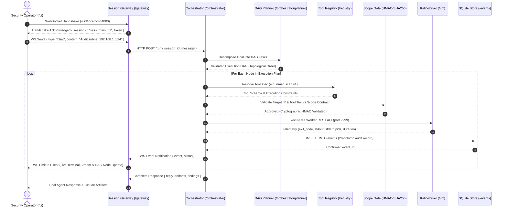

# KAIRO: System Architecture & Subsystem Topology

> **Comprehensive Technical Architecture Specification**  
> **Target Release**: KAIRO v4.0.0 (Claude Production Architecture)  
> **Scope**: Monorepo boundaries, inter-service IPC protocols, state lifecycles, and execution sandboxing.

---

## Table of Contents

1. [Monorepo Architecture Overview](#1-monorepo-architecture-overview)
2. [End-to-End Execution Lifecycle](#2-end-to-end-execution-lifecycle)
3. [Service Boundaries & Default Ports](#3-service-boundaries--default-ports)
4. [Session Gateway Architecture (`/gateway`)](#4-session-gateway-architecture-gateway)
5. [Autonomous Orchestrator & Cognitive Loop (`/orchestrator`)](#5-autonomous-orchestrator--cognitive-loop-orchestrator)
6. [ToolSpec Registry & 7-Gate Conformance Engine (`/registry`, `/sdk`)](#6-toolspec-registry--7-gate-conformance-engine-registry-sdk)
7. [Cryptographic Scope Boundary & Security Gate](#7-cryptographic-scope-boundary--security-gate)
8. [Disposable Kali Linux Virtualization Sandbox (`/vm`)](#8-disposable-kali-linux-virtualization-sandbox-vm)
9. [Immutable 20-Field SQLite Audit Event Store (`/events`)](#9-immutable-20-field-sqlite-audit-event-store-events)
10. [Client Interface Layer (`/ui`) & Claude Aesthetics](#10-client-interface-layer-ui--claude-aesthetics)

---

## 1. Monorepo Architecture Overview

KAIRO is organized as a local-first, modular monorepo engineered for autonomous cybersecurity operations. The architecture strictly decouples the client user interface, connection gateway, autonomous orchestration engine, declarative tool registry, execution sandbox, and forensic audit event database.

```text
.
├── /ui           # Next.js 16 + React 19 Client (Anthropic Claude UI Archetype)
├── /gateway      # Node.js + TypeScript WebSocket & Session Gateway (ws, tsx)
├── /orchestrator # Python 3.12+ FastAPI Autonomous Agent, Planner, & Critic Engine
├── /registry     # Declarative 16-field YAML ToolSpecs & multi-language loaders
├── /events       # Immutable SQLite operational audit event log (20-field schema)
├── /sdk          # ToolSpec SDK, CLI scaffolding generator, & 7-Gate Conformance Suite
├── /training     # SFT, DPO, and GRPO fine-tuning pipelines & dataset repositories
├── /lab          # Docker Compose vulnerability testbeds (Mini-DVWA, Mini-Metasploitable)
├── /vm           # Headless Kali Linux VM worker agent & snapshot rollback manager
├── /scripts      # Maintenance, screenshot capture, and deployment automation scripts
└── /tests        # Pytest & TypeScript verification suites across all service boundaries
```

---

## 2. End-to-End Execution Lifecycle

The lifecycle of an autonomous security directive follows a deterministic, 10-step sequence:



---

## 3. Service Boundaries & Default Ports

| Service Component | Directory | Runtime / Framework | Port | Access Boundary |
| :--- | :--- | :--- | :--- | :--- |
| **Client UI** | [`/ui`](file:///c:/New%20Volume%20(D)/dev/ui) | Next.js 16 (Turbopack), React 19 | `3000` | Browser localhost |
| **Session Gateway** | [`/gateway`](file:///c:/New%20Volume%20(D)/dev/gateway) | Node.js 20+, TypeScript, `ws` | `4000` | WebSocket / REST |
| **Agent Orchestrator** | [`/orchestrator`](file:///c:/New%20Volume%20(D)/dev/orchestrator) | Python 3.12, FastAPI, Uvicorn | `8000` | Localhost internal |
| **noVNC Desktop Stream** | [`/orchestrator`](file:///c:/New%20Volume%20(D)/dev/orchestrator) | RFB 003.008 WebSockets | `6080` | Browser WebSocket |
| **Kali Worker REST** | [`/vm`](file:///c:/New%20Volume%20(D)/dev/vm) | Python FastAPI in VM | `9999` | VirtualBox Host-Only (`192.168.56.x`) |
| **Kali SSH Management** | [`/vm`](file:///c:/New%20Volume%20(D)/dev/vm) | OpenSSH Server | `2222` | Port forwarded |
| **Lab Targets (DVWA)** | [`/lab`](file:///c:/New%20Volume%20(D)/dev/lab) | Docker Compose | `8080` | Local test subnet |

---

## 4. Session Gateway Architecture (`/gateway`)

The Session Gateway acts as a high-concurrency, stateful multiplexer between browser sessions and the underlying agent processes:
- **WebSocket Multiplexing**: Connects to `ws://localhost:4000`, tracks active client heartbeats, and routes messages based on `sessionId`.
- **Message Types**:
  - `chat`: User prompt directives sent to the Orchestrator loop.
  - `tool_call`: Direct tool execution requests for dev testing.
  - `planner_decompose`: Requests to generate a multi-step DAG plan.
  - `terminal_stream`: Bidirectional raw PTY streaming for live Kali interactive shells.
- **Session Isolation**: Each session maintains an isolated context buffer, assigned task ID, and event stream listener.

---

## 5. Autonomous Orchestrator & Cognitive Loop (`/orchestrator`)

The Orchestrator implements an autonomous **Observer-Critic-Recovery** loop:
1. **Observer Phase**: Inspects recent outputs, exit codes, and network artifacts from previous executions.
2. **Evaluator & Tool Selector**: Matches goal criteria against declarative ToolSpecs using semantic affinity, environment compatibility, and historical reliability scoring.
3. **Critic Phase**: Evaluates generated parameters against GBNF grammar rules and verifies compliance with the active cryptographic Scope Contract.
4. **Self-Healing Recovery Agent**: If a tool fails (e.g. `nmap` timeout or port exhaustion), the recovery loop captures the failure narrative, updates the recovery path, and dynamically selects a fall-back adapter (e.g. `subfinder` or raw socket probe).

---

## 6. ToolSpec Registry & 7-Gate Conformance Engine (`/registry`, `/sdk`)

All platform capabilities are codified in strict **16-field YAML ToolSpecs**:
- **Metadata**: Name, version, description, category, author, license.
- **Safety**: Privilege tier (`Tier 1`: Safe Read-Only, `Tier 2`: Active CLI, `Tier 3`: Interactive GUI), timeout seconds, memory cap.
- **Schema**: JSON Schema definition of inputs and typed outputs.
- **7-Gate Conformance Engine** ([`sdk/conformance.py`](file:///c:/New%20Volume%20(D)/dev/sdk)):
  1. *Gate 1: YAML Schema Integrity* (Strict 16-field verification)
  2. *Gate 2: Argument Validation* (Pydantic / JSON schema types)
  3. *Gate 3: Execution Sandbox Safety* (Subprocess containment & resource limits)
  4. *Gate 4: Output Typing Conformance* (Structured stdout/stderr matching)
  5. *Gate 5: Scope Enforcement* (Target address inside CIDR boundary)
  6. *Gate 6: Timeout & Memory Caps* (Strict SIGKILL enforcement)
  7. *Gate 7: Audit Log Compliance* (Verified 20-field SQLite record generation)

---

## 7. Cryptographic Scope Boundary & Security Gate

To guarantee safety during autonomous red-teaming:
- Operators define an authorized **Scope Contract** specifying allowed CIDR blocks (e.g. `192.168.1.0/24`), excluded critical hosts (e.g. default gateways), and max permitted tool tier.
- Every tool parameter targeting an IP or domain is parsed and verified by the HMAC-SHA256 signature gate prior to process creation.
- Any attempt to interact with an out-of-scope host immediately aborts the task with a security violation event.

---

## 8. Disposable Kali Linux Virtualization Sandbox (`/vm`)

All active security tools run inside an isolated virtual machine:
- Headless Kali Linux VM running under VirtualBox or QEMU.
- Configured with a dedicated worker REST API listening on host-only interface `192.168.56.x:9999`.
- **Snapshot Rollback**: Prior to running risky operations, an automatic snapshot is committed. If a task compromises stability or leaves residual state, the VM worker reverts to the pristine snapshot automatically.

---

## 9. Immutable 20-Field SQLite Audit Event Store (`/events`)

Every platform action creates an immutable forensic record in `events/events.db`:
- Columns: `id`, `session_id`, `task_id`, `timestamp`, `actor`, `tool_id`, `tool_version`, `requested_args`, `normalized_args`, `process_id`, `start_time`, `end_time`, `exit_code`, `stdout_ref`, `stderr_ref`, `artifact_refs`, `screenshots`, `network_context`, `result_summary`, `confidence`, `parent_event`.
- Indexed for real-time sub-millisecond full-text search and filtering in the UI Event Log.

---

## 10. Client Interface Layer (`/ui`) & Claude Aesthetics

The frontend is built on **Next.js 16** with Turbopack, following the **Anthropic Claude UI archetype**:
- Warm Slate & Obsidian dark theme (`#181816`, `#141413`).
- Signature Anthropic Terracotta Coral accents (`#d97757`).
- Newsreader editorial serif headings & Inter modern sans body.
- Collapsible Left Sidebar with `+ New session` and Operator profile.
- Claude 3.7 Extended Thinking accordions (`✦ Thought for 1.4s ▾`).
- Rich Claude Artifact tool cards with deep links into the Advanced Console drawer.
