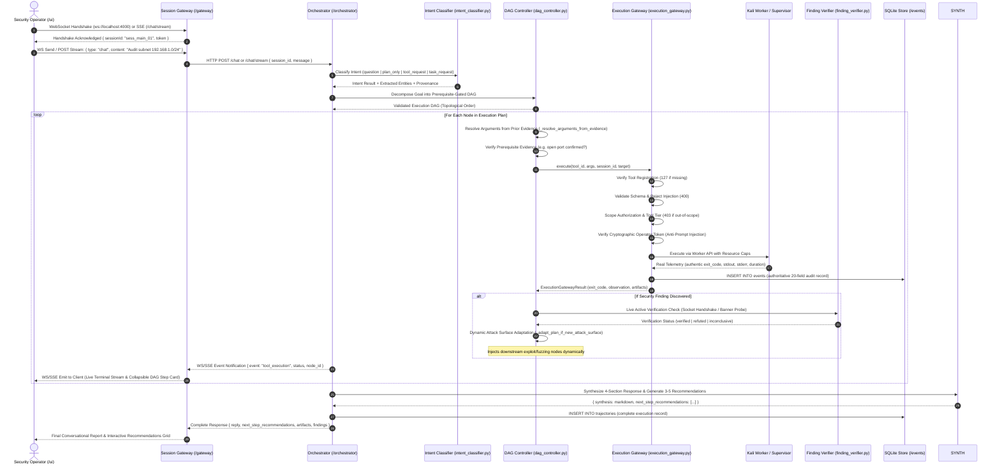

# KAIRO: System Architecture & Subsystem Topology

> **Comprehensive Technical Architecture Specification**  
> **Target Release**: KAIRO v4.0.0 (Claude Production Architecture)  
> **Scope**: Monorepo boundaries, inter-service IPC protocols, state lifecycles, and execution sandboxing.

---

## Table of Contents

1. [Monorepo Architecture Overview](#1-monorepo-architecture-overview)
2. [End-to-End Execution Lifecycle](#2-end-to-end-execution-lifecycle)
3. [Service Boundaries & Default Ports](#3-service-boundaries--default-ports)
4. [Session Gateway Architecture (`/gateway`)](#4-session-gateway-architecture-gateway)
5. [Autonomous Orchestrator & Cognitive Loop (`/orchestrator`)](#5-autonomous-orchestrator--cognitive-loop-orchestrator)
6. [ToolSpec Registry & 7-Gate Conformance Engine (`/registry`, `/sdk`)](#6-toolspec-registry--7-gate-conformance-engine-registry-sdk)
7. [Cryptographic Scope Boundary & Security Gate](#7-cryptographic-scope-boundary--security-gate)
8. [Disposable Kali Linux Virtualization Sandbox (`/vm`)](#8-disposable-kali-linux-virtualization-sandbox-vm)
9. [Immutable SQLite Audit Event & Trajectory Store (`/events`)](#9-immutable-sqlite-audit-event--trajectory-store-events)
10. [Client Interface Layer (`/ui`) & Claude Aesthetics](#10-client-interface-layer-ui--claude-aesthetics)

---

## 1. Monorepo Architecture Overview

KAIRO is organized as a local-first, modular monorepo engineered for autonomous cybersecurity operations. The architecture strictly decouples the client user interface, connection gateway, autonomous orchestration engine, declarative tool registry, execution sandbox, and forensic audit event database.

```text
.
├── /ui           # Next.js 16 + React 19 Client (Anthropic Claude UI Archetype)
├── /gateway      # Node.js + TypeScript WebSocket & Session Gateway (ws, tsx)
├── /orchestrator # Python 3.12+ FastAPI Autonomous Agent, Planner, & Critic Engine
├── /registry     # Declarative 16-field YAML ToolSpecs & multi-language loaders
├── /events       # Immutable SQLite operational audit event log (20-field schema)
├── /sdk          # ToolSpec SDK, CLI scaffolding generator, & 7-Gate Conformance Suite
├── /training     # SFT, DPO, and GRPO fine-tuning pipelines & dataset repositories
├── /lab          # Docker Compose vulnerability testbeds (Mini-DVWA, Mini-Metasploitable)
├── /vm           # Headless Kali Linux VM worker agent & snapshot rollback manager
├── /scripts      # Maintenance, testing harnesses, and deployment automation scripts
└── /tests        # Pytest & TypeScript verification suites across all service boundaries
```

---

## 2. End-to-End Execution Lifecycle

The lifecycle of an autonomous security directive follows a deterministic sequence incorporating dynamic intent classification, DAG prerequisite gating, authentic execution telemetry, and active finding verification:



---

## 3. Service Boundaries & Default Ports

| Service Component | Directory | Runtime / Framework | Port | Access Boundary |
| :--- | :--- | :--- | :--- | :--- |
| **Client UI** | [`/ui`](file:///c:/New%20Volume%20(D)/dev/ui) | Next.js 16 (Turbopack), React 19 | `3000` | Browser localhost |
| **Session Gateway** | [`/gateway`](file:///c:/New%20Volume%20(D)/dev/gateway) | Node.js 20+, TypeScript, `ws` | `4000` | WebSocket / REST |
| **Agent Orchestrator** | [`/orchestrator`](file:///c:/New%20Volume%20(D)/dev/orchestrator) | Python 3.12, FastAPI, Uvicorn | `8000` | Localhost internal |
| **noVNC Desktop Stream** | [`/orchestrator`](file:///c:/New%20Volume%20(D)/dev/orchestrator) | RFB 003.008 WebSockets | `6080` | Browser WebSocket |
| **Kali Worker REST** | [`/vm`](file:///c:/New%20Volume%20(D)/dev/vm) | Python FastAPI in VM | `9999` | VirtualBox Host-Only (`192.168.56.x`) |
| **Kali SSH Management** | [`/vm`](file:///c:/New%20Volume%20(D)/dev/vm) | OpenSSH Server | `2222` | Port forwarded |
| **Lab Targets (DVWA)** | [`/lab`](file:///c:/New%20Volume%20(D)/dev/lab) | Docker Compose | `8080` | Local test subnet |

---

## 4. Session Gateway Architecture (`/gateway`)

The Session Gateway acts as a high-concurrency, stateful multiplexer between browser sessions and the underlying agent processes:

- **WebSocket & SSE Multiplexing**: Connects to `ws://localhost:4000` and proxies real-time Server-Sent Events (`POST /chat/stream`), tracking active client heartbeats and routing messages based on `sessionId`.
- **Message Types**:
  - `chat`: User prompt directives sent to the Orchestrator loop (supports full conversational replies and streaming chunks).
  - `tool_call`: Direct tool execution requests for dev testing.
  - `planner_decompose`: Requests to generate a multi-step DAG plan.
  - `terminal_stream`: Bidirectional raw PTY streaming for live Kali interactive shells.
- **Session Isolation**: Each session maintains an isolated context buffer, assigned task ID, and event stream listener.

---

## 5. Autonomous Orchestrator & Cognitive Loop (`/orchestrator`)

The Orchestrator implements an autonomous **Observer-Critic-Recovery** loop augmented by a **Centralized Execution Gateway**, genuine local neural model runtimes, topological prerequisite gating, dynamic attack surface adaptation, and live finding verification:

1. **Intent Classification & Provenance (`intent_classifier.py`)**: Directives are classified upfront (`question`, `plan_only`, `tool_request`, `task_request`) with extracted target entities and explicit provenance logging. Non-operational questions and plan-only requests execute 0 tools.
2. **Local Neural Model Runtime (`model_runtime.py`)**:
   - **`TransformersLocalRuntime`**: Executes fine-tuned causal LM checkpoints (`training/checkpoints/grpo/kairo-grpo-final`) directly via PyTorch/HuggingFace transformers.
   - **`LlamaCppLocalRuntime`**: High-throughput GGUF quantized model inference constrained by runtime GBNF grammars.
   - **Zero-Cloud Guarantee**: Cloud provider fallbacks are strictly prohibited; missing models transition to `FAILED` rather than leaking prompts.
3. **Topological DAG Controller (`dag_controller.py`)**:
   - **Prerequisite Evidence Gating**: Web application scanners (`nikto.scan.v1`) or directory bruteforcers (`gobuster.dir.v1`) are blocked unless network reconnaissance nodes have verified an active HTTP/HTTPS listener on the target.
   - **Dynamic DAG Output Chaining (`_resolve_arguments_from_evidence`)**: Automatically extracts live IPs, discovered open ports, and validated URLs from predecessor node outputs and injects them into downstream parameters (e.g. chaining `nmap.scan.v1` open ports directly into `nikto.scan.v1` or `hydra.ssh.v1`).
   - **Mid-Execution Attack Surface Adaptation (`_adapt_plan_if_new_attack_surface`)**: When node verification yields new attack vectors (e.g. discovered port 80/443, discovered SSH port 22, or newly enumerated subdomains), the DAG dynamically synthesizes and appends specialized evaluation nodes before concluding.
4. **Centralized Execution Gateway (`execution_gateway.py`)**:
   - **Single Choke Point**: All routes leading to execution (agent loop, DAG nodes, recovery agent, direct tools) must pass through this 7-stage authorization perimeter.
   - **Fail-Closed Scope Perimeter**: Validates active Scope Contracts, CIDR targets, and tool tiers before adapter dispatch.
   - **Anti-Prompt Self-Authorization**: Rejects prompt injection claims of authority. Requires cryptographic operator tokens (`KAIRO-OP-...`) for target modifications.
   - **Injection Defense & Tool Registration**: Rejects shell metacharacters (400) and unregistered tools (127) without process creation.
5. **Trustworthy Execution Plane (`agent.py`)**:
   - **Authentic Exit Codes**: Real process return codes are strictly propagated (e.g. `1` for network timeout/socket error, `127` for unregistered tool, never synthesized `0`).
   - **Deterministic CLI Command Line**: Exact shell invocation strings (`command_line`) are deterministically reconstructed.
   - **Structured Typed Invocation**: The formal tool contract (`typed_invocation` with tool name, version, and typed arguments) is recorded for every step.
   - **Failure Isolation**: If a node fails, observation ingestion ignores the failed run, preventing corrupted state from contaminating downstream planning.
6. **Active Finding Verification Engine (`finding_verifier.py`)**:
   - When security findings (e.g. open ports, banners, vulnerabilities) are recorded, the agent executes authorized live checks.
   - Executes TCP socket connect handshakes with microsecond latency measurement, HTTP/HTTPS banner requests, and banner comparisons.
   - Scope-gated: Out-of-scope targets are strictly blocked (`blocked_out_of_scope`).
   - Dynamically updates finding confidence (+0.2 on verified, -0.4 on refuted).
7. **Critic & Self-Healing Recovery (`critic.py`, `recovery_agent.py`)**: Evaluates results against success criteria and triggers compensatory recovery paths without crashing the graph.
8. **Conversational Synthesis & Recommendations Engine (`conversational_synthesizer.py`)**:
   - Generates professional, human-grade conversational responses structured into 4 mandatory sections:
     - `## 1. Executive Summary`: High-level operational outcome, posture summary, and scope certification.
     - `## 2. Step-by-Step Breakdown`: Chronological narrative of tool invocations, exit codes, and durations.
     - `## 3. Verified Findings & Evidence`: Concrete discovered vulnerabilities, open ports, software banners, and raw evidence.
     - `## 4. What We Can Do Next`: Proactive strategic guidance and logical next attack vectors.
   - Generates **3–5 Actionable Next-Step Recommendations**: Every run supplies click-to-run recommendations equipped with valid ToolSpec IDs, pre-filled arguments, priority badges (`HIGH`, `MEDIUM`, `LOW`), and contextual rationale.
9. **Local Model Reliability & Schema Self-Correction (`failover_router.py`)**:
   - `attempt_self_correction` validates model tool-calling outputs against `registry/schema/toolspec.schema.json`.
   - On syntax or schema violations, it triggers a fast iterative local correction prompt feeding back schema errors. If self-correction fails, traffic automatically fails over to the designated pair model.
10. **Continuous Trajectory Logging & Dataset Curation (`events/schema.sql`, `training_manager.py`)**:
    - Persists complete end-to-end mission trajectories into SQLite `trajectories` table.
    - Curates clean, successful trajectories for SFT and DPO preference datasets.

---

## 6. ToolSpec Registry & 7-Gate Conformance Engine (`/registry`, `/sdk`)

All platform capabilities are codified in strict **16-field YAML ToolSpecs**:

- **Metadata**: Name, version, description, category, author, license.
- **Safety**: Privilege tier (`Tier 1`: Safe Read-Only, `Tier 2`: Active CLI, `Tier 3`: Interactive GUI), timeout seconds, memory cap.
- **Schema**: JSON Schema definition of inputs and typed outputs.
- **7-Gate Conformance Engine** ([`sdk/conformance.py`](file:///c:/New%20Volume%20(D)/dev/sdk)):
  1. *Gate 1: YAML Schema Integrity* (Strict 16-field verification)
  2. *Gate 2: Argument Validation* (Pydantic / JSON schema types)
  3. *Gate 3: Execution Sandbox Safety* (Subprocess containment & resource limits)
  4. *Gate 4: Output Typing Conformance* (Structured stdout/stderr matching)
  5. *Gate 5: Scope Enforcement* (Target address inside CIDR boundary)
  6. *Gate 6: Timeout & Memory Caps* (Strict SIGKILL enforcement)
  7. *Gate 7: Audit Log Compliance* (Verified 20-field SQLite record generation)

---

## 7. Cryptographic Scope Boundary & Security Gate

To guarantee safety during autonomous red-teaming:

- Operators define an authorized **Scope Contract** specifying allowed CIDR blocks (e.g. `192.168.1.0/24`), excluded critical hosts (e.g. default gateways), and max permitted tool tier.
- Every tool parameter targeting an IP or domain is parsed and verified by the HMAC-SHA256 signature gate prior to process creation.
- Any attempt to interact with an out-of-scope host immediately aborts the task with a security violation event.

---

## 8. Disposable Kali Linux Virtualization Sandbox (`/vm`)

All active security tools run inside an isolated virtual machine:

- Headless Kali Linux VM running under VirtualBox or QEMU.
- Configured with a dedicated worker REST API listening on host-only interface `192.168.56.x:9999`.
- **Snapshot Rollback**: Prior to running risky operations, an automatic snapshot is committed. If a task compromises stability or leaves residual state, the VM worker reverts to the pristine snapshot automatically.

---

## 9. Immutable SQLite Audit Event & Trajectory Store (`/events`)

Every platform action creates an immutable forensic record in `events/events.db`:

- **Events Table (20 Fields)**: `id`, `session_id`, `task_id`, `timestamp`, `actor`, `tool_id`, `tool_version`, `requested_args`, `normalized_args`, `process_id`, `start_time`, `end_time`, `exit_code`, `stdout_ref`, `stderr_ref`, `artifact_refs`, `screenshots`, `network_context`, `result_summary`, `confidence`, `parent_event`.
  - Indexed for real-time sub-millisecond full-text search and filtering in the UI Event Log.
- **Trajectories Table (`trajectories`)**: Records complete end-to-end mission trajectories (`id`, `session_id`, `task_id`, `goal`, `steps_json`, `recommendations_json`, `success`, `created_at`).
  - Harvested by `curate_trajectories_for_training()` to automatically generate high-fidelity SFT JSONL datasets and DPO preference datasets without manual labeling.

---

## 10. Client Interface Layer (`/ui`) & Claude Aesthetics

The frontend is built on **Next.js 16** with Turbopack, following the **Anthropic Claude UI archetype**:

- **Warm Slate & Obsidian Palette**: Dark theme (`#181816`, `#141413`) with subtle borders (`#2d2d2a`).
- **Signature Terracotta Coral Accents**: `#d97757` and `#e08365` for active states, thinking pulses, and interactive recommendations.
- **Newsreader Editorial Serif Headings & Inter Sans Body**: Refined editorial typography for executive reports and verified findings.
- **Collapsible DAG Step Cards (`ClaudeOutputCard.tsx`)**:
  - Compact summary rows featuring status badges (`COMPLETED`, `RUNNING`, `FAILED`), ToolSpec IDs, target, and duration.
  - One-click expandable accordions revealing tool invocation parameters, live standard output snippets, and verified evidence findings.
- **Interactive Next-Step Recommendations Grid**:
  - Displays 3–5 proactive follow-up recommendations below the synthesized report.
  - Each recommendation chip features priority badges (`HIGH`, `MEDIUM`, `LOW`), tool description, rationale, and a **"Run Tool"** direct-execution button that pre-populates and launches the recommended scan.
- **Header Split-View Toggles**:
  - Top navigation bar provides rapid split-pane toggles for **Terminal** (live Kali interactive shell) and **Kali GUI (noVNC)**.
- **Claude 3.7 Extended Thinking Accordions**: `✦ Thought for 1.4s ▾` collapsible reasoning previews with animated glow pulses.
- **Rich Claude Artifact Tool Cards**: Deep links into the Advanced Console drawer, findings inspector, and scope verification badges.

---

## 11. Model Training, Alignment & Reinforcement Learning (`/training`)

Kairo houses a dedicated ML training pipeline engineered specifically for Small Language Models (SLMs) from 380M to 2.0B parameters:

- **PyTorch Transformer (`training/model.py`)**: Custom decoder-only architecture with RMSNorm, RoPE, Grouped Query Attention (GQA), and SwiGLU activations.
- **Supervised Fine-Tuning (`training/trl_sft.py`)**: Hugging Face TRL SFTTrainer with automated schema cleaning and XML tool-call parsing.
- **Direct Preference Optimization (`training/dpo.py`)**: Aligns models on paired comparisons to eliminate hallucinated tool calls and unauthorized CIDR scanning.
- **Group Relative Policy Optimization (`training/grpo.py`)**: Optimizes generation with verifiable rule-based rewards: Schema Validity (+1.0), Registry Existence (+1.0), Scope Adherence (+1.0), and Task Goal (+2.0).

---

## 12. Autonomous Model Evolution & Dual-Model Local Routing

Kairo continuously improves its own capabilities and guarantees local air-gapped resilience:

- **Evolution Controller (`orchestrator/model_evolution_controller.py`)**: Evaluates operational telemetry every 60s against [`orchestrator/evolution_policy.yaml`](file:///c:/New%20Volume%20(D)/dev/orchestrator/evolution_policy.yaml). Automatically triggers SFT training when $\ge 50$ new traces exist, scales parameter tiers upon accuracy plateaus, and rolls back if regression exceeds 2.5%.
- **Dual-Model Local Routing (`orchestrator/agent.py`)**:
  - Directs prompts first to the primary custom fine-tuned model (e.g. `kairo-scale-1.5b-grpo`).
  - If schema formatting or parser errors occur, dynamically routes to the secondary local fallback model (e.g. `Qwen2.5-Coder-7B-Instruct`).
  - Zero external cloud calls: All inferences execute strictly against local weights.
  - Imbues every inference with an immutable 6-tuple audit signature (`model_id`, `version`, `prompt_format`, `adapter`, `benchmark_score`, `inference_source`).
- **Failover Router (`orchestrator/failover_router.py`)**: High-availability inference router managing all model pairs in [`models.yaml`](file:///c:/New%20Volume%20(D)/dev/models.yaml). If a primary model encounters consecutive timeouts or schema errors, traffic seamlessly fails over to the designated fallback model.

---

## 13. Vulnerability Testbeds & Autonomous Benchmark Lab (`/lab`)

Empirical verification relies on isolated local vulnerability targets:

- **Docker Compose Testbeds**: Mini-DVWA (Web vulnerabilities) and Mini-Metasploitable (Network services).
- **Benchmark Suites**: 50-task Golden benchmark (`lab/tasks.py`) and 120-task Full benchmark (`lab/extended_tasks.py`).
- **Benchmark Sweeps**: Multi-model sequential sweep runner persisting evaluation runs and comparative scores to `lab/history.json`.

---

## 14. Master Verification & Testing Architecture (`/tests`)

A comprehensive **52-suite test harness** certifies every service boundary:

- Conformance testing for all 27 ToolSpecs with 7-gate certification.
- Subsystem integration for DAG planner, cognitive self-healing loop, and evidence store.
- Trustworthy execution testing: authentic exit codes, CLI reconstruction, finding verification, and DAG prerequisite isolation.
- Cryptographic HMAC verification, Scope Contract CIDR boundaries, and tamper detection.
- VirtualBox VM sandboxing and automated snapshot rollback.
- Multi-client real-time synchronization, intent classification flows, and chaos testing.
