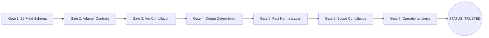

# KAIRO: Testing & Quality Assurance Architecture

> **Comprehensive Specification for Test Suites, Conformance Gates, Chaos Engineering & QA Protocols**  
> **Target Release**: KAIRO v4.0.0

---

## 1. Testing Philosophy & Guarantees

In autonomous cybersecurity platforms, software bugs and runtime hallucinations can lead to catastrophic side-effects, such as scanning unauthorized corporate networks or triggering unplanned outages. Kairo enforces a **rigorous testing and validation framework** underpinned by:

1. **Deterministic Conformance**: Every tool must pass a 7-gate automated conformance engine before admission to the trusted registry.
2. **Cryptographic Containment**: Cryptographic verification tests ensure no action executes without a valid HMAC-signed Scope Contract.
3. **Hard Fault Boundaries**: Process supervisor and VM limits guarantee that resource-exhaustion, infinite loops, and fork-bombs are killed within predetermined thresholds.
4. **Autonomous Self-Healing**: Recovery and critic tests verify that parser mismatches and tool failures trigger intelligent compensatory actions rather than silent abortion.

---

## 2. Test Architecture & Pytest Harness

The test harness comprises **52+ comprehensive test suites** located in `/tests`, executed via Python's `pytest` framework and Node.js for TypeScript interfaces:

```text
/tests
├── Unit & Schema Tests          # ToolSpec JSON Schema, Tokenizer, Datasets
├── Adapter & Conformance Tests  # 7-Gate verification for Tier 1, 2, and 3 tools
├── Trustworthy Execution Tests  # Authentic exit codes, CLI reconstruction, finding verification
├── DAG Controller & Planning    # Prerequisite evidence gating, topological execution, recovery
├── Cognitive Engine Tests       # DAG Planner, Observer, Critic, Recovery
├── Security & Isolation Tests   # Scope Contract HMAC, VM Sandboxing, Resource Caps
├── Model Intent & Dual-Routing  # Dynamic intent classification, local-only routing, 6-tuple audit
├── Model & Training Tests       # SFT, DPO, GRPO rewards, Scale stages
├── Multi-Client & Collab Tests  # Project presence, Audit Explorer, WebSocket sync
└── Chaos & Extreme Stress Tests # 100-node DAGs, CIDR fuzzing, network partitions
```

---

## 3. The 7-Gate Conformance Engine (`python -m sdk verify-toolspec`)

Every tool added to Kairo must pass all 7 automated gates:



1. **Gate 1: Blueprint Schema**: Validates all 16 required fields against `registry/schema/toolspec.schema.json`.
2. **Gate 2: Adapter Contract**: Verifies Python adapter inherits from `ToolAdapter` and implements `build_args()` and `parse()`.
3. **Gate 3: Arg Compilation**: Tests parameter coercion, default arguments, and flag injection safety.
4. **Gate 4: Output Determinism**: Ensures parser handles raw output, empty responses, and non-zero exit codes without unhandled exceptions.
5. **Gate 5: Fact Normalization**: Verifies extraction of standard `ObservationFact` entities (open ports, discovered vulnerabilities, hosts).
6. **Gate 6: Scope Compliance**: Verifies that adapter respects target parameters and rejects out-of-scope targets.
7. **Gate 7: Operational Limits**: Enforces timeout $\le 300\text{s}$, explicit rollback declarations, and privilege boundaries.

---

## 4. Trustworthy Execution & Verification Testing

Kairo provides rigorous verification suites ensuring execution results and reported findings are truthful and tamper-proof:

### 1. Authentic Telemetry & Honest Synthesis (`tests/test_trustworthy_execution.py` - 13 Tests)

- **Authentic Non-Zero Exit Codes**: Verifies runtime errors emit exit code `1` and unregistered tools emit exit code `127`. No synthetic `0` exit codes are permitted on failure.
- **Deterministic CLI Command Line**: Validates exact shell strings are reconstructed across single executions and DAG node executions.
- **Structured Typed Invocations**: Verifies every step records a typed invocation contract `{"tool": ..., "version": ..., "arguments": ...}`.
- **Honest Synthesis & Failure Badging**: Proves that failed tasks render explicit failure banners (`❌ Execution Failed`) and accurate error root causes rather than hallucinating "Audit Complete" or "No vulnerabilities".
- **DAG Failure State Isolation**: Verifies that failed DAG steps (`exit_code != 0`) are skipped during observation ingestion so failed runs cannot poison downstream context.

### 2. DAG Controller & Prerequisite Evidence Gating (`tests/test_dag_controller.py` - 15 Tests)

- **Prerequisite Evidence Gating**: Proves web scanners and password auditors are blocked from executing unless network reconnaissance nodes have confirmed active open ports.
- **Topological & Parallel Execution**: Validates serial vs parallel multi-task dispatch and dependency resolution.
- **Recovery Lineage**: Verifies that failed steps trigger compensatory recovery suggestions without graph termination.

### 3. Model Intent Flow & Dual-Model Local Routing (`tests/test_model_intent_flow.py`, `tests/test_model_integration.py` - 25 Tests)

- **Intent Classification**: Tests 4-class intent routing (`question`, `plan_only`, `tool_request`, `task_request`) with extracted target entities.
- **Dual-Model Air-Gapped Fallback**: Tests primary custom model execution and automatic failover to local fallback model upon schema errors.
- **Audit 6-Tuple Provenance**: Verifies that every inference event records `model_id`, `version`, `prompt_format`, `adapter`, `benchmark_score`, and `inference_source`.

---

## 5. Chaos Engineering & Extreme User Stress

Kairo includes purpose-built chaos engineering scripts in `/scripts`:

### 1. WebSocket Stream Chaos (`scripts/break_website_chaos.py`)

Simulates hostile network environments:

- **Packet Drop Simulation**: Randomly drops 15% of inbound/outbound WebSocket messages.
- **Malformed Payloads**: Injects corrupted JSON, null fields, and out-of-spec event numbers.
- **Latency Spikes**: Introduces artificial jitter (200ms - 2000ms) to test UI optimism and loader states.

### 2. Extreme Operator Simulation (`scripts/test_extreme_user_simulation.py`)

Simulates erratic human operator behavior:

- Rapid clicking on drawer tabs and action buttons (< 50ms interval).
- Simultaneous prompt submissions across multiple browser tabs.
- Hot-swapping model selectors while tasks are actively executing.
- Rapidly changing Scope Contract parameters during live tool execution.

---

## 6. Running the Master Test Matrix

```bash
# 1. Run all 52+ test suites with verbose output
python -m pytest -v

# 2. Run trustworthy execution and DAG controller tests
python -m pytest tests/test_trustworthy_execution.py tests/test_dag_controller.py -v

# 3. Run model intent flow and dual-model integration tests
python -m pytest tests/test_model_intent_flow.py tests/test_model_integration.py -v

# 4. Run fast unit and schema tests only
python -m pytest tests/test_toolspec_registry.py tests/test_tool_selection.py -v

# 5. Run security and scope authorization tests
python -m pytest tests/test_scope_contract.py tests/test_workspace_and_auth_gateway.py -v

# 6. Run cognitive loop and recovery tests
python -m pytest tests/test_observer_critic_recovery.py tests/test_planner.py -v

# 7. Run model training and reinforcement learning tests
python -m pytest tests/test_grpo_training_and_rewards.py tests/test_scale_stages_pipeline.py -v
```
